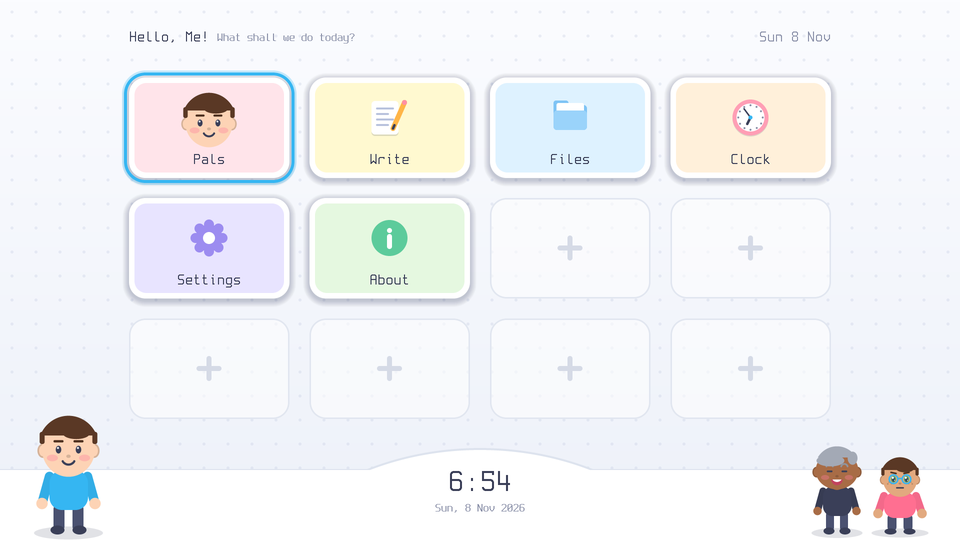
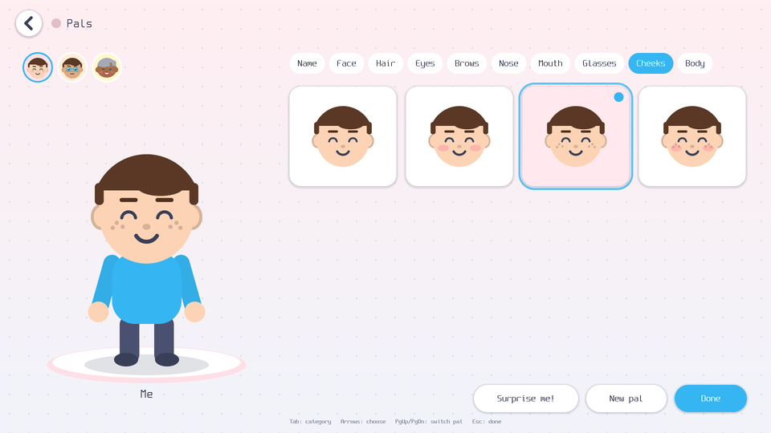
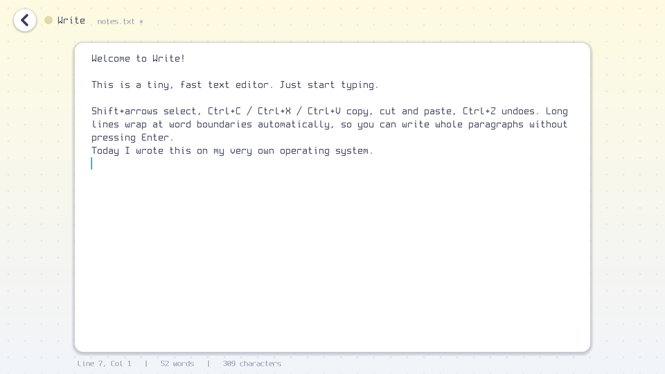
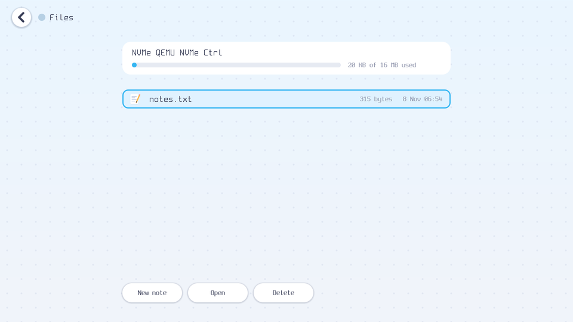
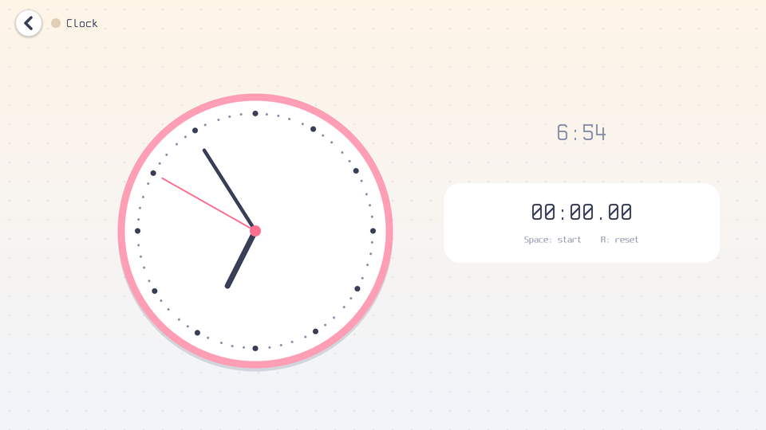
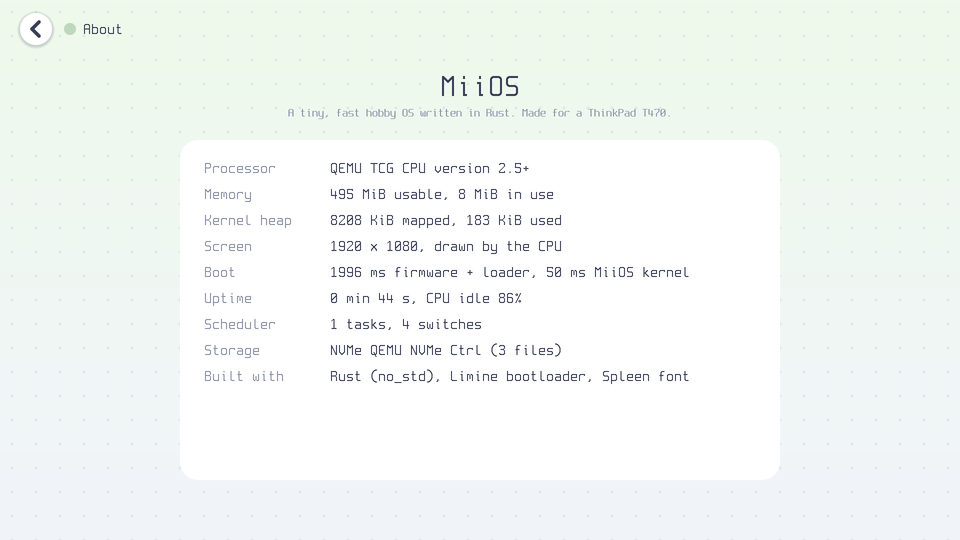

# MiiOS

A tiny, fast hobby operating system written in Rust for a Lenovo ThinkPad T470
(i5-7200U, 8 GB RAM, 1920×1080, UEFI). It has a playful, pastel home screen,
your own cartoon avatars ("Pals"), a text editor, and files that survive a reboot.

This README explains **every choice**, so you can learn OS development from it.
Each milestone has its own section below.

### Two editions

| | **MiiOS Classic** (bare metal) | **MiiOS for ThinkPad** (Linux edition) |
|---|---|---|
| What runs underneath | Nothing: our own Rust kernel, drivers and filesystem | A small Debian Linux (kernel, drivers, Wi-Fi) |
| Home screen | The MiiOS UI | **The same MiiOS UI code**, as a Linux program |
| Wi-Fi, web browser, sound | ❌ | ✅ NetworkManager, Firefox, PipeWire |
| Your 3D Miis walking on the home screen | ❌ (2D Pals instead) | ✅ |
| Mii Hub | ❌ | ✅ preinstalled, updates itself |
| Install onto the laptop | — | ✅ Settings → Install MiiOS |
| Boot time / size | ~50 ms kernel, 420 KiB | a few seconds, ~2.4 GB |

**Just want it on your ThinkPad?** Jump to [Get MiiOS for ThinkPad](#get-miios-for-thinkpad-download-flash-install).
The rest of this README walks through building MiiOS Classic step by step, then the Linux edition.

| Home | Pals (avatar maker) |
|---|---|
|  |  |
| **Write** (text editor) | **Files** |
|  |  |
| **Clock** | **About** (live system info) |
|  |  |

## Status at a glance

| # | Milestone | Status |
|---|---|---|
| 1 | Boots in QEMU, prints text | ✅ |
| 2 | Framebuffer graphics: shapes, rounded rects, bitmap fonts, dirty rectangles | ✅ |
| 3 | PS/2 keyboard + mouse/TrackPoint | ✅ |
| 4 | Memory: frame allocator, paging, heap | ✅ |
| 5 | Timer, interrupts, cooperative scheduler | ✅ |
| 6 | Home screen with tile grid, keyboard + mouse navigation | ✅ |
| 7 | Avatar creator (Pals), avatars on the home screen | ✅ |
| 8 | Text editor (Write) | ✅ |
| 9 | Bootable USB image + T470 flashing guide | ✅ (QEMU-tested as a USB stick; **not yet tried on the real T470**) |
| 10 | Stretch: NVMe + SATA drivers, MiiFS filesystem, USB keyboard/mouse | ✅ (QEMU-tested) |
| – | Linux edition: Wi-Fi, web browser, installer, your 3D Miis, Mii Hub | ✅ (QEMU-tested; Wi-Fi needs the real laptop) |
| – | Ethernet | ✅ in the Linux edition (NetworkManager connects automatically when you plug in a cable); ❌ in Classic |

**Numbers** (QEMU with a *software-emulated* CPU, so real hardware will be faster):

| | |
|---|---|
| Kernel file size | **~389 KiB** (including four embedded fonts) |
| Kernel start → home screen | **~40–50 ms** (10 ms of it is measuring the CPU clock) |
| Firmware + bootloader before that | ~2 s in QEMU; on the T470 it's mostly Lenovo's POST (~5–8 s) |
| Finding disks | ~5–10 ms, done in the background while the UI is already up |
| An animated frame | a few ms emulated; only changed rectangles are redrawn |
| Idle | 0 frames drawn, CPU halted ~98% of the time |

### Where to start reading the code

1. `kernel/src/main.rs`: the boot sequence, top to bottom.
2. `kernel/src/gfx/canvas.rs` + `screen.rs`: how pixels get drawn, and why only dirty rectangles
   are redrawn.
3. `kernel/src/ui/shell.rs` + `home.rs`: the main loop and the home screen.
4. `kernel/src/ui/avatar.rs`: drawing a whole cartoon person from ellipses.
5. `kernel/src/arch/`: interrupts and timers, the "classic OS" core.
6. `kernel/src/drivers/` + `kernel/src/fs/`: talking to real hardware, and a crash-safe filesystem.

---

## Quick start (Linux)

1. Install the tools (Debian/Ubuntu; for Fedora use `dnf install qemu-system-x86 edk2-ovmf mtools util-linux git`):
   ```bash
   sudo apt install qemu-system-x86 ovmf mtools fdisk git build-essential
   ```
2. Install Rust (skip this step if you already have `rustup`):
   ```bash
   curl --proto '=https' --tlsv1.2 -sSf https://sh.rustup.rs | sh
   ```
3. Build and run:
   ```bash
   make run
   ```
   The first build downloads the Limine bootloader and the Rust bare-metal target.
   A QEMU window opens, and the kernel's log messages appear in your terminal.
4. Close the QEMU window (or press Ctrl+C in the terminal) to stop.

Other commands: `make image` builds only the disk image (`build/miios.img`), `make size`
prints the kernel size, and `make clean` deletes all build output.

> **Safety:** QEMU only sees the file `build/miios.img`. Nothing in this project
> writes to your real disks. Only the USB flashing step (milestone 9), which you
> run yourself, touches a real device.

---

## Big-picture choices

| Choice | Why |
|---|---|
| **Rust, `no_std`** | Memory safety without a garbage collector. `no_std` means we don't use Rust's standard library, because it expects an OS underneath, and we *are* the OS. |
| **Stable Rust**, target `x86_64-unknown-none` | No nightly compiler needed. This target already has no OS and no SSE/AVX, so interrupts and task switches never need to save the big vector registers. |
| **Limine bootloader** (not the `bootloader` crate) | Very fast, small, well tested on real laptops, and hands us a ready framebuffer, memory map and page tables. We write the ~150 lines of Limine bindings ourselves (`kernel/src/boot.rs`) because the official `limine` crate needs nightly Rust. |
| **QEMU + OVMF** | QEMU emulates a whole PC; OVMF is UEFI firmware for it. Like your T470, it boots via UEFI from an NVMe disk. |
| **Release profile**: `opt-level=3`, `lto="fat"`, `codegen-units=1`, `panic="abort"`, `strip` | The fastest code the compiler can make. Link-time optimisation removes unused code across crates, and `panic=abort` drops the unwinding machinery. |
| **Higher-half kernel** at `0xffffffff80000000` | The standard layout. The kernel lives in the top 2 GiB of the address space, which leaves the bottom free. |

### Files

| Path | What it is |
|---|---|
| `kernel/src/main.rs` | `kmain`, the first Rust function Limine jumps to. |
| `kernel/src/boot.rs` | Requests to Limine: framebuffer, memory map, etc. |
| `kernel/src/arch/` | CPU-specific code: I/O ports, interrupts, GDT, timer chips. |
| `kernel/src/serial.rs` | Debug log over the serial port. `log!()` prints to your terminal under QEMU. |
| `kernel/src/time.rs` | Measures the CPU's timestamp counter so we can tell the time. |
| `kernel/src/gfx/` | Graphics: fonts, drawing, dirty rectangles, crash screen. |
| `kernel/src/mem/` | Physical frames, page tables, heap. |
| `kernel/src/input/` | PS/2 keyboard + mouse, event queue. |
| `kernel/src/task.rs` | Cooperative task scheduler. |
| `kernel/src/ui/` | Shell, home screen, apps (Pals, Write, Files, Clock, Settings, About). |
| `kernel/src/drivers/` | PCI, NVMe, SATA (AHCI), USB (xHCI). |
| `kernel/src/fs/` | GPT partitions, MiiFS filesystem, storage manager. |
| `tools/flash-usb.sh` | Safely writes the image to a USB stick. |
| `kernel/linker.ld` | Tells the linker where in memory each part of the kernel goes. |
| `kernel/build.rs` | Passes the linker script to the linker. |
| `.cargo/config.toml` | Always builds for bare metal, with kernel-friendly compiler flags. |
| `limine.conf` | Limine menu config. `timeout: 0` boots instantly. |
| `tools/mkimage.sh` | Builds the GPT disk image (FAT32 boot partition + MiiOS data partition). |
| `Makefile` | `make run`, `make image`, … |

---

## Milestone 1: boot and print text ✅

**What happens when you power on:**

1. UEFI firmware (OVMF in QEMU, Lenovo's firmware on the T470) starts up and looks for
   `\EFI\BOOT\BOOTX64.EFI` on a FAT32 partition. That file is Limine.
2. Limine reads `boot/limine/limine.conf`, loads `boot/kernel` (our ELF file) into
   memory, sets up 64-bit mode and page tables, fills in our *requests*, and jumps to `kmain`.
3. `kmain` sets up the serial port, measures CPU speed, paints the screen and draws text
   using the embedded **Spleen** bitmap font (BSD licence, `kernel/assets/fonts/`).

**How Limine "requests" work:** the kernel contains small structs with magic numbers in a
section called `.limine_requests`. Limine finds them before starting us and writes a
pointer to its answer into each one. No function calls, no parsing.

**Measuring boot time:** the CPU's Time Stamp Counter (TSC) starts at zero at power-on
and counts at a fixed rate. We measure that rate against the 1.193 MHz PIT timer chip
(10 ms), then `TSC / rate` gives *time since power-on*.

**Results (QEMU without KVM, i.e. a pure software CPU, so slower than real hardware):**

| | |
|---|---|
| Power-on → kernel start (firmware + Limine) | 2.41 s (emulated firmware; on a T470 most of this is Lenovo's firmware) |
| Kernel start → text on screen | **15 ms** (10 ms of it is the TSC calibration) |
| Kernel size | **66 KiB** |
| Screen | 1920×1080, 32 bits per pixel |

What you should see: a soft white screen with "Hello from MiiOS!" in the top-left, and
log lines in the terminal.

---

## Milestone 2: framebuffer graphics ✅

**Files:** `kernel/src/gfx/` (`canvas.rs`, `screen.rs`, `math.rs`, `color.rs`, `rect.rs`, `font.rs`), `kernel/src/mem/early.rs`, `kernel/src/demo.rs`.

**Key ideas:**

1. **Back buffer.** We draw into an 8 MB copy of the screen in normal RAM, never into
   screen memory directly. Screen memory is slow to read, and drawing there directly
   would show half-finished frames (flicker).
2. **Dirty rectangles** (`screen.rs`). Every change says "this rectangle changed". Before
   copying to the screen we redraw *only* those rectangles. The trick: the whole scene's
   draw code runs with a *clip rectangle*, so anything outside it is skipped almost for free.
   Overlapping rectangles are merged, with at most 32 tracked.
3. **Fixed-point math** (`math.rs`). Numbers like 3.25 are stored as `3.25 × 256 = 832` in
   an ordinary integer. There's no floating point anywhere, so it's fast and needs no special
   CPU state. Even sine comes from a 256-entry table computed at compile time.
4. **Anti-aliasing** (`canvas.rs`). Smooth edges on circles, ellipses and rounded rectangles.
   Each pixel row is sampled at 4 heights. Pixels fully inside a shape are filled with one fast
   `rep stosd` instruction, and only edge pixels are blended. Thick lines and arcs (smiles!)
   use *signed distance functions*: "how far is this pixel from the shape?" turns directly into
   how opaque the pixel is.
5. **Alpha blending** with two multiplies per pixel, by processing red and blue together.
6. **Fonts.** Spleen in 8×16, 12×24 and 16×32, embedded at compile time with `include_bytes!`.
7. **Early allocator** (`mem/early.rs`). Before the real memory manager exists, the 8 MB back
   buffer is carved off the end of the largest free RAM region in Limine's memory map.

**Results (QEMU, software CPU emulation, so expect real hardware to be several times faster):**

| | |
|---|---|
| Full 1920×1080 scene draw + copy | ~45–60 ms (done once, at start) |
| One animation frame of the bouncing ball | **~0.2–0.3 ms**, ~10,000 pixels instead of 2,073,600 (≈200× less work) |
| Kernel start → first frame | ~55–75 ms |
| Kernel size | **113 KiB** (the three fonts are ~56 KiB of that) |

What you should see: six pastel tiles (the first with a blue selection ring), a smiling face,
lines of different thickness, and a blue ball bouncing smoothly. The terminal prints how long
each frame took.

---

## Milestone 3: keyboard, mouse and TrackPoint ✅

**Files:** `kernel/src/input/` (`ps2.rs`, `keyboard.rs`, `mouse.rs`, `mod.rs`), `kernel/src/gfx/cursor.rs`.

**How it works:**

1. **The PS/2 controller** (`ps2.rs`) is an old but still-present chip, today built into the
   T470's embedded controller. It has two ports: the keyboard, and a "mouse" port that the
   TrackPoint and touchpad share. We talk to it through I/O ports `0x60` (data) and `0x64`
   (status/command). Setup steps: disable both ports, flush old bytes, turn on *translation*
   (so every keyboard speaks the simple "scancode set 1"), enable the ports, then configure
   the mouse.
2. **Keyboard** (`keyboard.rs`). Every key sends a *scancode* when pressed, and the same code
   + `0x80` when released. Arrow keys etc. are prefixed with `0xE0`. A table turns codes into
   US-layout characters, and Shift/Ctrl/Alt/Caps Lock are tracked as we go.
3. **Mouse** (`mouse.rs`). The mouse sends 3-byte packets (buttons, X movement, Y movement),
   or 4 bytes if it has a scroll wheel. We unlock the wheel with the classic "IntelliMouse"
   knock: set sample rate 200, 100, 80, then ask for the ID. Bit 3 of the first byte is always
   1, which lets us re-sync if a byte is lost.
4. **Event queue** (`input/mod.rs`). Drivers push `Event`s into a fixed-size ring buffer and
   apps pop them. It uses no locks and no heap, so it's safe to push from interrupt handlers
   later.
5. **Pointer.** A 13×21 bitmap arrow. When it moves, only its old and new rectangles are
   redrawn (~550 pixels).
6. **For now we *poll*:** the main loop keeps asking "any bytes?". Milestone 5 switches to
   interrupts, so the CPU can sleep between key presses.

**T470 notes:** the built-in keyboard and TrackPoint work through PS/2. The touchpad works as a
basic mouse (move + click), but has no multi-touch gestures. **USB keyboards and mice won't
work** until the USB stretch goal. (Some firmware has a "USB legacy" option that pretends
a USB keyboard is PS/2, so it *may* work by luck.)

**Results:** a pointer move redraws ~550 pixels in ~0.1 ms (emulated). Kernel size: **112 KiB**.

What you should see: type and the text appears in the white box, with the last key shown
below it. Move the mouse (click inside the QEMU window to capture it; Ctrl+Alt+G releases
it): tiles lift when hovered and get a blue ring when clicked.

---

## Milestone 4: memory management ✅

**Files:** `kernel/src/mem/` (`frame.rs`, `paging.rs`, `heap.rs`, `early.rs`).

1. **Physical frames** (`frame.rs`). RAM is split into 4 KiB *frames*. The allocator walks the
   free regions of Limine's memory map front to back ("bump allocation"). Freed frames go on a
   *free list* stored inside the free frames themselves, so it uses zero extra memory. Both
   allocate and free are O(1).
2. **Paging** (`paging.rs`). Code uses *virtual* addresses, and the CPU translates them through a
   4-level tree of tables into *physical* addresses. `map_page()` walks the tree, creating
   missing tables, and writes the final entry. Our own virtual regions:

   | Virtual address | What |
   |---|---|
   | `0xFFFF_8000_…` | Limine's direct map of all RAM ("HHDM") |
   | `0xFFFF_9000_…` | **Our heap** (up to 1 GiB reserved, only used parts backed by RAM) |
   | `0xFFFF_A000_…` | **Framebuffer**, write-combining |
   | `0xFFFF_B000_…` | **Device registers** (MMIO), uncached |
   | `0xFFFF_FFFF_8…` | The kernel itself |

3. **Write-combining framebuffer.** The *Page Attribute Table* (PAT) lets each page pick a caching
   mode. Screen memory gets **write-combining**: the CPU gathers writes into 64-byte bursts instead
   of sending them one by one. On real hardware this often makes screen copies 5–10× faster.
   QEMU doesn't emulate caches, so you'll only notice it on the T470. Device registers get
   **uncached**, because every read and write must really reach the device.
4. **Heap** (`heap.rs`). `#[global_allocator]` hooks up Rust's `alloc` crate, so `Vec`, `Box` and
   `String` work. The allocator itself is the small, well-tested `linked_list_allocator` crate;
   we supply the memory. It starts with 2 MiB and grows by mapping more frames when it runs out.
5. **Rule:** drawing code never allocates. The heap is for things made once, like documents and
   buffers.

**Boot self-test:** allocate a `Box`, a 3 MB `Vec` (forces the heap to grow) and a `String`; check
the sum; translate a heap address back to its physical frame. The serial log shows the result.

**Results:** kernel **125 KiB**. QEMU shows 495 MiB usable with `-m 512M`; the T470 will show
about 7.8 GiB.

---

## Milestone 5: interrupts, timer and tasks ✅

**Files:** `kernel/src/arch/` (`gdt.rs`, `idt.rs`, `pic.rs`, `apic.rs`), `kernel/src/task.rs`, `kernel/src/gfx/panic_screen.rs`.

1. **Interrupts** let hardware tap the CPU on the shoulder ("a key was pressed!") instead of
   the CPU constantly asking. That means the CPU can *sleep* (`hlt`) when there's nothing to do.
2. **GDT + TSS** (`gdt.rs`). Leftover 1980s machinery the CPU still requires. The useful part
   for us is the TSS, which gives the *double fault* handler its own emergency stack. Without
   it, a stack overflow would silently reboot the laptop.
3. **IDT** (`idt.rs`). A table of 256 entries saying where to jump for each interrupt number:
   0–31 are CPU exceptions (page fault, divide by zero…), 32–47 are hardware IRQs.
   - The entry code is a few lines of **assembly** that saves all registers, calls
     `interrupt_dispatch` in Rust, then restores them and returns with `iretq`.
   - The assembler's `.irp` loop generates the 48 stubs for us.
   - (Rust's `extern "x86-interrupt"` would do this automatically, but it needs nightly.)
4. **PIC** (`pic.rs`). The old interrupt controller. We move its IRQs from numbers 8–15 (which
   clash with CPU exceptions) to 32–47, and unmask only the timer, keyboard and mouse.
5. **Local APIC** (`apic.rs`). The modern per-core controller. We set its LINT0 input to
   pass PIC interrupts through ("virtual wire"), instead of trusting the firmware to have done it.
6. **PIT timer.** Fires 1000 times a second, giving `ticks_ms()`. For precise timing we still
   use the CPU's TSC. As a safety net, the timer also checks the PS/2 controller every tick,
   so the keyboard works even if a laptop routes its IRQ oddly.
7. **Cooperative scheduler** (`task.rs`). Each task has its own 64 KiB stack.
   - A task runs until it calls `yield_now()`, `sleep_ms()` or `wait_input()`.
   - Switching tasks (`switch_context`, 15 assembly instructions) saves the 6 registers the
     compiler expects to survive a call, swaps stack pointers, and restores them.
   - If no task is ready, the CPU halts until the next interrupt. We disable interrupts
     while checking, then use `sti; hlt`, so a wake-up can't slip in between.
   - *Cooperative* (tasks choose when to pause) instead of *preemptive* (the timer forces
     switches): far simpler, with no locks between tasks, and plenty for a one-user machine
     where we write every task.
8. **Crash screen** (`panic_screen.rs`). The T470 has no serial port, so a panic draws a sad face
   plus the error message (e.g. `page fault at rip=…`) directly on the screen.

**Results:** CPU **~98% idle** while showing the UI (halted between events). Kernel **145 KiB**.

What you should see: the same test screen, plus a line showing uptime, timer ticks, 2 tasks
(UI + clock), task switches, and CPU idle %, updated every second by the clock task.

> A bug worth learning from: my first try crashed with a page fault on an *instruction fetch*.
> The interrupt assembly ended by switching to the read-only data section, and the next
> assembly block (the task switcher) silently landed there too, in memory marked
> "not executable". The fix was `.pushsection` / `.popsection`.

---

## Milestone 6: home screen ✅

**Files:** `kernel/src/ui/` (`shell.rs`, `home.rs`, `anim.rs`, `icons.rs`, `widgets.rs`, `clock.rs`, `placeholder.rs`, `mod.rs`).

1. **Apps.** Every screen implements the small `App` trait: `event()` (input), `tick()` (one 60 Hz
   animation step), `second()` (clocks) and `draw()`. Each one reports which rectangles it
   changed, so the shell only redraws those.
2. **Shell** (`shell.rs`). Owns the screen and the pointer.
   - Turns raw mouse movement into a pointer position, with simple acceleration so the
     TrackPoint feels quick.
   - Turns button presses into clicks.
   - Hold the **middle button and push** the TrackPoint to scroll, like on Linux.
   - Typing hides the pointer.
   - Plays the **zoom animation**: the tile grows to fill the screen, then the app appears.
     Esc or the round back button shrinks it back into its tile.
3. **Main loop.** Handle input → step animations at a fixed 60 Hz → update clocks once a
   second → redraw damaged rectangles → sleep until the next input, frame or second. When
   nothing moves, the CPU is halted almost all the time.
4. **Springs** (`anim.rs`). The selection ring glides between tiles and the selected tile grows
   6%, both driven by springs: `acceleration = stiffness × distance − damping × speed`. With
   slightly too little damping they overshoot a touch and settle, which gives the bouncy
   console-menu feel. At start-up the tiles pop in one after another (`ease_out_back`).
5. **Icons are code, not images** (`icons.rs`). A pencil and notebook, folder, live analog
   clock, gear, info badge. They're built from circles, rounded rectangles and thick lines,
   so they're sharp at any size and take a few hundred bytes each.
6. **Big clock.** The footer shows the time in a 32×64 font. Only the 96 printable characters
   are copied out of the font file, and that happens at **compile time** (a `const` block), so
   the other 416 glyphs never reach the kernel file.
7. **Layout is computed from the screen size**, so it also works at other resolutions.
8. **Time** comes from the bootloader (which reads the laptop's battery-backed clock) plus
   uptime, and `clock.rs` converts seconds into a date with integer maths. There's no time zone
   yet, so it shows UTC; Settings will fix that.

**Results (QEMU software emulation):**

| | |
|---|---|
| Kernel start → home screen | **~38 ms** (incl. 10 ms timer calibration and memory self-test) |
| Animated frame while navigating | ~6.5 ms emulated (expect ~1 ms on the i5-7200U) |
| Idle | 0 frames drawn, CPU halted |
| Kernel size | **185 KiB** |

**How to use it:** arrow keys move the selection and **Enter** opens. The mouse/TrackPoint
selects by hovering and opens with a click. **Esc** goes back.

---

## Milestone 7: Pals, the avatar maker ✅

**Files:** `kernel/src/ui/avatar.rs` (data + drawing), `kernel/src/ui/pals.rs` (the editor app), `kernel/src/ui/home.rs` (pals on the home screen).

1. **An avatar is ~30 bytes:** name, plus small numbers for face shape, skin tone, hair style and
   colour, eyes and eye colour, brows, nose, mouth, glasses and frame colour, cheeks, body size and
   shirt colour. That's tiny to keep in memory and trivial to save to disk later.
2. **Drawn entirely from shapes**, sized relative to the head width, so the same code draws a
   70 px roster bubble, a tile icon or a 540 px preview.
   - Parts: 5 face shapes, 8 hair styles (bald, short, bob, spiky, long, bun, curly, swoop),
     6 eye styles, 4 brows, 4 noses, 6 mouths, 4 glasses, 4 cheek styles (blush/freckles),
     6 body sizes, with 8-colour palettes for skin, hair, eyes, frames and shirts.
   - Hair is drawn in two layers: back hair before the face, front hair after. The "cap" of
     hair is a big ellipse cut off at the fringe line using the **clip rectangle**, the same
     trick dirty rectangles use.
   - Glasses are **ring outlines** (a new signed-distance primitive), so the eyes show through.
3. **The editor** (Pals tile).
   - Left: your pal on a stage, plus a row of all your pals.
   - Right: category tabs, then a grid of choices. Each choice is a **mini preview of your own
     pal** with that option applied. Below that are colour swatches and buttons.
   - Changes apply instantly and the preview "pops" on a spring.
   - **Surprise me!** randomises the look (keeping the name), **New pal** adds a random friend
     (up to 8), and **Name** lets you type a name.
4. **On the home screen** your pal (pal #0) stands bottom-left and **waves** when you arrive.
   Up to four friends stand bottom-right. Someone **blinks** every few seconds. The Pals tile
   shows your face, and the greeting says "Hello, *name*!".
5. **Cheap animation.** Blinks and waves are short tweens started by the once-a-second clock
   tick. Only the avatar's rectangle is redrawn, and the CPU goes back to sleep afterwards.

**Keyboard:** Tab / Shift+Tab = category, arrows = choose (applies immediately), Enter = press a
button, PgUp/PgDn = switch pal, Esc = done. **Mouse:** click anything; the scroll wheel (or
middle-button + TrackPoint) flips categories.

**Kernel size:** **228 KiB**. Pals live in memory for now; saving them needs the storage stretch goal.

> **About the "inspired by" part:** the feel (big friendly heads, part-by-part editing, pastel
> menus) is inspired by console avatar systems, but every shape, colour and layout here is our
> own original design. No Nintendo art, names or sounds are used.

---

## Milestone 8: Write, the text editor ✅

**File:** `kernel/src/ui/write.rs`.

1. **Document = list of lines** (`Vec<Vec<u8>>`). Typing inserts into one short line, which is fast
   whatever the document size. Enter splits a line, and Backspace at the start joins two.
2. **Word wrap.** Lines are cut into screen *rows* of up to ~88 characters, breaking after a space
   when possible. The row table is rebuilt after each edit (a quick pass over the text) into a
   reused buffer, so no allocation.
3. **Minimal redraw.** The old and new row tables are compared, and only rows that actually
   changed are marked dirty. A normal keystroke redraws one text row (~1400×38 pixels) plus the
   status line.
4. **Editing:**
   - **Moving:** arrows, Home/End, PgUp/PgDn, Ctrl+Home/End, and Ctrl+←/→ to jump by word.
     Up/Down remember the column you were in.
   - **Selecting:** Shift + any movement, or click and drag with the mouse.
   - **Clipboard:** Ctrl+A (select all), Ctrl+C / Ctrl+X / Ctrl+V.
   - **Undo:** Ctrl+Z, up to 64 steps. Typing is grouped by word.
   - **Other:** Tab inserts 4 spaces, the mouse wheel (or middle button + TrackPoint) scrolls,
     the caret blinks, the pointer hides while typing, and a status line shows
     line/column/word/character counts.
5. **Ctrl+S** saves the file once the storage stretch goal exists. Until then the document stays
   in memory while MiiOS runs.

**Kernel size:** **253 KiB**.

---

## Milestone 9: boot your ThinkPad T470 from a USB stick ✅

### Part A: make the USB stick (on your Linux computer)

You need a USB stick of **128 MB or larger**. **Everything on it will be erased.**

1. Build the image:
   ```bash
   make image
   ```
   This creates `build/miios.img` (82 MB).
2. Optional: test it the way the ThinkPad will see it, as a USB stick:
   ```bash
   make run-usb
   ```
3. Plug in the USB stick. If your desktop opens it in a file manager, close that window.
4. List the USB disks the flashing script will accept:
   ```bash
   ./tools/flash-usb.sh
   ```
   Find your stick by its size and model, e.g. `sdb  14.9G usb  SanDisk_Ultra`. Its device is
   then `/dev/sdb`.
5. If any of its partitions are mounted, unmount them (replace `sdb` with yours):
   ```bash
   sudo umount /dev/sdb?*
   ```
6. Write MiiOS to it (replace `sdb` with yours):
   ```bash
   make usb DEV=/dev/sdb
   ```
   The script **refuses** anything that isn't a whole USB disk (so it can't touch your
   computer's internal drive) and asks you to type the name again before erasing.
7. Wait for "Done!", then unplug the stick.

### Part B: set up the T470's firmware (one time)

1. Turn the ThinkPad on and immediately tap **F1** to enter the BIOS setup.
2. Go to **Security → Secure Boot** and set **Secure Boot** to **Disabled**. Limine isn't signed
   by Microsoft, so Secure Boot would block it. You can turn it back on later for other OSes.
3. Go to **Startup → UEFI/Legacy Boot** and choose **UEFI Only** (or "Both" with UEFI first).
4. Go to **Config → USB** and make sure **USB UEFI BIOS Support** is **Enabled**.
5. Press **F10**, then **Yes**, to save and restart.

### Part C: boot MiiOS

1. Plug the USB stick into the T470.
2. Power on and tap **F12** for the boot menu.
3. Pick the USB stick (it shows its brand name, e.g. "USB HDD: SanDisk").
4. After the Lenovo logo you should see the MiiOS home screen within a fraction of a second.
   There's no boot menu, because `timeout: 0` boots instantly.
5. To turn it off, **hold the power button for ~4 seconds**. Nothing is saved to disk yet, so
   this is safe.
6. To go back to your normal OS, unplug the stick and restart.

**Your internal drive is never touched.** MiiOS has no disk driver yet, so it *can't* write
to the T470's drive at all.

### Safety changes made for real hardware

| Problem on real laptops | What MiiOS does |
|---|---|
| Skylake firmware may **switch off the old PIT timer chip** ("8254 clock gating"). | The 1000 Hz tick now comes from the **local APIC timer**, which is built into the CPU and measured against the TSC at boot. The PIT is only a fallback. The TSC measurement times out safely and falls back to asking the CPU (CPUID leaf `0x16`). |
| Firmware might route keyboard interrupts oddly. | The APIC sets LINT0 to pass the PIC through, *and* the timer tick also checks the PS/2 controller every millisecond, so the keyboard works either way. |
| There's no serial port to read crash messages. | Crashes draw a sad-face screen with the error text. |

### What works on the T470, and what doesn't (yet)

| ✅ Works | ❌ Does not work |
|---|---|
| UEFI boot from USB, 1920×1080 screen | **Wi-Fi, Bluetooth** (huge drivers + firmware). Ethernet is a stretch goal. |
| Built-in keyboard (US layout), and USB keyboards/mice plugged straight into the laptop | **GPU acceleration**: drawing is done by the CPU on the firmware framebuffer. Fast enough for this UI, but the resolution is fixed and there's no external monitor support. |
| TrackPoint + buttons, touchpad as a basic mouse | **Web browser, sound, webcam** |
| Clock with time zone setting | **USB hubs, USB sticks as storage** (the stick you boot from can't be written by MiiOS) |
| Home screen, Pals, Write, Files, Clock, Settings, About, crash screen, Turn off / Restart | **Sleep/suspend, battery level, fan control** |
| Saving notes/pals to the internal SSD (NVMe or SATA) after you set it up in Files | **Ethernet** (no driver yet) |
| | Touchpad gestures (two-finger scroll, etc.) |

**Brightness and volume keys:** on ThinkPads, the embedded controller often handles brightness
by itself, so Fn+F5/F6 *may* work even in MiiOS. Volume won't do anything (there's no sound driver).

**Expected boot time on the T470:** ~5–8 s of Lenovo firmware (POST), then Limine (~0.1–0.3 s),
then ~15–20 ms of MiiOS kernel until the home screen. Under QEMU the kernel part measures
**~40 ms** with a fully *emulated* CPU, so the real i5 should be several times quicker.

If the screen stays black or the keyboard doesn't respond, note exactly what you see (even a
photo of the crash screen helps). The fix is usually small.

---

## Stretch goal: saving files (NVMe + SATA drivers, MiiFS) ✅

**Files:** `kernel/src/drivers/` (`pci.rs`, `nvme.rs`, `ahci.rs`, `block.rs`), `kernel/src/fs/` (`gpt.rs`, `miifs.rs`, `crc32.rs`, `mod.rs`), `kernel/src/ui/files.rs`, `kernel/src/ui/settings.rs`, `kernel/src/arch/power.rs`.

### How it fits together

1. **PCI** (`pci.rs`) finds devices. Each one reports what it is (a "class code") and where its
   registers live (BARs). We start at bus 0 and follow bridges, instead of trying all 256 buses.
2. **Two disk drivers**, because T470s shipped with either kind of SSD:
   - **NVMe** (`nvme.rs`). Commands go into a *submission queue* in RAM; we ring a *doorbell*
     register; the SSD moves the data itself (DMA) and posts a result into a *completion queue*.
     A "phase" bit tells new results from old ones.
   - **SATA/AHCI** (`ahci.rs`). Each port gets a command list and a command table holding an ATA
     command (`READ DMA EXT`, `WRITE DMA EXT`, `IDENTIFY`, `FLUSH`).
   - Both are **polled**. While waiting, they `yield_now()` to the scheduler, so the UI keeps
     animating during disk work.
3. **Disks are found in a background task** (`fs::probe_task`) while the home screen is already
   showing, so storage adds nothing to boot time. It takes about 5–10 ms in QEMU.
4. **GPT** (`gpt.rs`) reads the partition table. MiiOS only uses a partition with **its own type
   GUID** `4D69694F-5344-6174-6150-617274000001` (hex for "MiiOSDataPart"). The USB image
   already contains one, called `MIIOS-DATA`.
5. **MiiFS** (`miifs.rs`), our own tiny filesystem:
   - 4 KiB blocks. Blocks 0 and 1 hold two copies of a file table (up to 62 files, plus a
     *generation* number and a CRC-32 checksum). Each file is one run of consecutive blocks.
   - **Crash safety (copy-on-write):** new data always goes to *free* blocks first, then the
     updated table is written to the *older* table slot with generation + 1. On mount, the
     valid slot with the highest generation wins. A power cut at any moment leaves you with
     either the old file or the new one, never a half-written mix.
6. **What gets saved:**
   - **Write** saves notes with **Ctrl+S**, and automatically when you leave (Esc or the back
     button).
   - **Pals** are saved when you leave the Pals app (`pals.dat`, 32 bytes per pal).
   - **Settings** (time zone) are saved to `settings.dat`.
   - Everything loads automatically at boot.
7. **Files app.** Lists your notes (newest first), with New note (`N`), Open (Enter or
   double-click) and Delete (asks first).
8. **Settings app.** Time zone (±30 min steps, so the clock shows your local time), plus
   **Restart** and **Turn off**. Turn off uses ACPI: we find the FADT table for the power
   register and scan the DSDT for the `_S5_` "soft off" value. Restart tries the ACPI reset
   register, then the Intel chipset reset port `0xCF9`, then the keyboard controller.

### Using it on the T470

You boot from the USB stick, but MiiOS has no USB *storage* driver, so it can't save to the stick.
Instead, Files offers to **set up your internal drive** (you said it can be wiped):

1. Open **Files**. It says "No MiiOS storage yet" and lists your internal drive, e.g.
   `1. NVMe SAMSUNG MZVLW256... (238 GB)` or `1. SATA ...`.
2. Press **1** (or click it).
3. A red warning appears. Type **ERASE** and press **Enter**.
4. MiiOS writes a fresh GPT with one big `MIIOS-DATA` partition and formats it. From then on,
   notes, pals and settings are saved there automatically.

> ⚠️ This **erases everything** on that drive, including Windows/Linux and all files. It only
> happens after you type ERASE. Nothing else in MiiOS ever writes outside its own partition.

**Tested in QEMU:** NVMe and SATA disks; save → reboot → load; and the "erase and set up a blank
disk" path. The GPT that MiiOS writes passes Linux's `sgdisk -v` check ("No problems found").

**Kernel size:** **360 KiB**.

### Clock and About apps ✅

- **Clock** (`ui/clockapp.rs`): a big analog clock whose second hand **sweeps smoothly**, using
  sub-second time from the TSC. Only the clock face's rectangle is redrawn each frame. There's
  also a stopwatch: **Space** starts/stops, **R** resets.
- **About** (`ui/about.rs`): live system facts, refreshed every second.
  - CPU name (read with the `cpuid` instruction), RAM, heap and screen.
  - **Boot timings** (firmware vs. kernel), uptime, and **CPU idle %**.
  - Scheduler stats and storage.

---

## Stretch goal: USB keyboard and mouse (xHCI) ✅

**File:** `kernel/src/drivers/xhci.rs`.

1. **xHCI** is the T470's USB 3 controller. It works from **rings** of 16-byte TRBs in RAM:
   - a *command ring*: "enable a slot", "address this device", "configure an endpoint";
   - a *transfer ring* per endpoint: the data itself;
   - an *event ring*: the controller's replies.

   A **cycle bit** in every TRB flips on each lap of a ring, so both sides can tell new entries
   from old ones. Writing to a **doorbell** register says "go".
2. **Start-up, with the real-hardware details:**
   - Take the controller from the firmware ("**BIOS handoff**"), then reset it.
   - Give it a device-context table plus any **scratchpad pages** it asks for. Intel
     controllers need these; QEMU's doesn't.
   - Support both **32- and 64-byte contexts**. Intel uses 64.
3. **Setting up each connected port's device:**
   1. Reset the port.
   2. **Enable Slot** → **Address Device**.
   3. Read the device descriptor, fixing EP0's packet size with **Evaluate Context** if needed.
   4. Read the configuration descriptor and find a HID interface using the **boot protocol**
      (keyboard = protocol 1, mouse = 2).
   5. **SET_CONFIGURATION**, **SET_PROTOCOL**(boot), then **Configure Endpoint** for its
      interrupt-IN endpoint.
   6. Keep one 8-byte request queued on that endpoint.
4. **Reports.** A boot keyboard sends 8 bytes: modifier bits plus up to 6 pressed keys (HID
   *usage* codes). Comparing each report with the previous one gives key presses and releases.
   USB keyboards don't auto-repeat by themselves, so the driver repeats a held key after 0.5 s,
   30 times a second.
5. **A background task** polls the event ring every 4 ms. If no USB keyboard or mouse is found,
   the task simply ends.

**Also fixed while testing:** on a PC *without* a PS/2 controller, its ports read `0xFF`, which
made the PS/2 "throw away old bytes" loop spin forever at boot. MiiOS now detects a missing
controller, and every PS/2 loop is bounded.

**Tested in QEMU** with the PS/2 controller *switched off*, so typing could only arrive over USB.

**Limits:** devices must be plugged directly into the laptop (no hubs, including keyboards with
a built-in hub), and only boot-protocol keyboards/mice are supported (nearly all are).

---

## MiiOS for ThinkPad (the Linux edition)

You asked for Wi-Fi and a real web browser. A from-scratch kernel can't realistically do that:
the Intel Wi-Fi driver alone is ~100,000 lines plus secret firmware, and a modern browser is tens
of millions. So this edition keeps **everything you see** from MiiOS and puts a small Linux
underneath to do the heavy lifting.

### How it's put together

```
  ┌──────────────────────────── what you see ─────────────────────────────┐
  │ miios-shell: the MiiOS home screen, Miis, Write, Files, Wi-Fi, ...    │  Rust, *same UI code* as Classic
  │ Firefox (Web, Mii Hub)          foot (Terminal)                       │
  ├──────────────────────────────────────────────────────────────────────┤
  │ Sway: shows one app at a time, full screen; slim bar with Home/apps   │
  ├──────────────────────────────────────────────────────────────────────┤
  │ Debian 13 Linux: kernel + drivers, Intel 8265 Wi-Fi firmware,         │
  │ NetworkManager, PipeWire sound, systemd                               │
  ├──────────────────────────────────────────────────────────────────────┤
  │ systemd-boot (boot menu, hidden: hold Space to see it)                │
  └──────────────────────────────────────────────────────────────────────┘
```

1. **One UI, two platforms.** `linux/shell/src/main.rs` includes the very same files as the kernel
   (`kernel/src/ui/*`, `kernel/src/gfx/*`) using `#[path = ...]`. Those files only ever ask the
   "platform" for a few things: the time, files, memory stats, power off, input. The kernel answers
   with its own drivers; `linux/shell/src/platform/` answers with Linux:
   - `window.rs`: a window (via the small `minifb` library) plus keyboard/mouse;
   - `fs.rs`: your files in `~/MiiOS`;
   - `host.rs`: Wi-Fi, battery, launching apps and the installer.

   The bare-metal kernel has a do-nothing version of `host` (`kernel/src/host.rs`), so both build
   from the same code.
2. **Sway** is a tiny "tiling window manager". Each app gets its own *workspace* (a full screen):
   1 Home, 2 Web, 3 Mii Hub, 4 Terminal. Apps are started *through* Sway (`swaymsg exec`), so a
   slow app's window still appears on its own workspace. Config: `linux/rootfs-overlay/etc/miios/sway.conf`.
3. **Auto-login:** the laptop logs the user `mii` in on screen 1, which starts Sway, which starts
   the home screen. (Password `miios`, only needed for `sudo` in the Terminal.)

### Your Miis, in 3D

- **Files.** Mii models (`.glb`, exported from Mii Creator) live in `~/MiiOS/miis/`. Lizzi and Joe
  come preloaded (`linux/miis/`).
- **A 3D renderer written for MiiOS** (`linux/shell/src/platform/mii3d.rs`, ~350 lines) draws them
  with the CPU:
  1. Read the glTF file: bones, meshes, textures.
  2. Pose the skeleton.
  3. *Skin* each vertex to its bones.
  4. Draw triangles with a depth buffer, textures and soft lighting.
  5. Draw at 2× size and shrink, for smooth edges.

  Mii face textures are *mirrored half-pictures*, which the renderer handles.
- **Walking.** The renderer rotates the hip, knee and shoulder bones along a sine wave; waving lifts
  one arm. Each new frame takes ~8 ms. Frames are cached, so a walk cycle costs nothing after the
  first lap.
- **The plaza** (`kernel/src/ui/plaza.rs`). Your Miis live along the bottom of the home screen.
  - Each one has a small state machine: stand and face you, wander somewhere, turn back, wave,
    say hi to a Mii nearby.
  - **Click a Mii** and it spins round, hops, waves and talks to you by name.
  - When you come back to the home screen, they all wave.
  - Standing Miis cost no CPU: decisions happen once a second.
- **Which Mii is you?** By default, the Mii whose name matches who created it (your own Mii). Change
  it in **Miis → This is me**.
- **Adding Miis** (the **Miis** tile → **Find new Miis**):
  - from a **USB stick**: put `.glb` files on it and plug it in (it's mounted read-only; nothing on
    it changes), or
  - from your **Downloads** folder: e.g. use **Make a Mii online** (opens Mii Creator in the
    browser), export as a 3D model and save it.

### Mii Hub, preinstalled and self-updating

1. The image contains the **newest release** of [sneekyedd/mii-hub](https://github.com/sneekyedd/mii-hub) at build time.
2. `miios-update-apps` (`linux/rootfs-overlay/usr/local/bin/`) checks GitHub for a newer release
   when you log in and **every 3 hours**, the same releases the desktop app updates from. When there
   is one, it downloads and swaps it in at `~/.local/share/miios/apps/mii-hub`. Your Miis, friends,
   coins and homes live in the browser's storage, so they survive updates, and Mii Hub shows its own
   patch notes the next time you open it.
3. The home screen runs a tiny web server on `127.0.0.1:8765` (only reachable from the laptop
   itself) that serves Mii Hub plus your MiiOS Miis.
4. **Mii Hub's code is not modified.** MiiOS adds one `<script>` tag (`miios-hook.js`) that hands
   your MiiOS Miis to Mii Hub through its normal **"Choose Mii .glb files…"** button. It also adds a
   flag so Mii Hub skips its random starter Miis when you have your own. If a future Mii Hub changes,
   these small additions just stop doing anything; nothing breaks.

### Wi-Fi

The **Wi-Fi** tile lists nearby networks (signal bars, a lock for secured ones). Pick one and type
the password. Behind the scenes it's NetworkManager (`nmcli`), the same as on most Linux laptops;
scanning and connecting run in the background so the screen never freezes. **Ethernet** needs
nothing: plug in a cable and it connects.

### Install onto the laptop

**Settings → Install MiiOS on this laptop** (only shown when running from the USB stick):

1. Pick the internal drive (USB drives and the stick you're running from are never offered).
2. Type **ERASE** to confirm.
3. Wait for the copy to finish (a few minutes).
4. Unplug the stick and press Enter to restart.

The installer (`linux/rootfs-overlay/usr/local/sbin/miios-install`):

1. makes a GPT disk with a 512 MB EFI partition + a Linux partition;
2. copies the running system with `rsync`, **including your Miis, notes and Wi-Fi passwords**;
3. writes new partition IDs into `/etc/fstab` and the boot entry;
4. registers MiiOS with the firmware (`efibootmgr`).

### Get MiiOS for ThinkPad (download, flash, install)

1. **Download:** open the MiiOS repository on GitHub → **Releases** → the newest **"MiiOS for
   ThinkPad"** → download `miios-linux.img.xz` (~700 MB). GitHub builds it automatically
   (`.github/workflows/linux-image.yml`) whenever the code changes, and once a month for security
   updates.
2. **Write it to a USB stick** (8 GB or bigger; everything on it is erased):
   - easiest: [balenaEtcher](https://etcher.balena.io/) → *Flash from file* → pick the `.xz` → pick the stick → *Flash*;
   - or on Linux:
     ```bash
     xz -dc miios-linux.img.xz | sudo dd of=/dev/sdX bs=4M conv=fsync status=progress
     ```
3. **Prepare the ThinkPad once:** power on, tap **F1**, **Security → Secure Boot → Disabled**,
   **F10** to save. (This is still needed: the boot loader isn't signed by Microsoft.)
4. **Boot it:** plug in the stick, power on, tap **F12**, pick the USB stick. The first boot takes a
   little longer, because MiiOS grows itself to fill the stick.
5. **Try everything from the stick.** It's a complete, *persistent* system: Wi-Fi passwords, Miis
   and notes are kept on the stick.
6. **Install:** Settings → Install MiiOS on this laptop → pick the drive → type ERASE → wait →
   unplug the stick → Enter.

**Getting around:** every app (Web, Mii Hub, Terminal) opens on its own screen, with the slim bar
on top. **Click "Home" in the bar** (or press ⊞) to go back to MiiOS; the app keeps running, so
clicking its name in the bar brings it back. Mii Hub opens like an app (no browser toolbars) but
deliberately *not* in Firefox's "kiosk" full-screen mode, which would hide the bar.

**Keys:** ⊞ (Windows key) = back to the MiiOS home screen, ⊞+Q = close the app you're in,
⊞+W = web, ⊞+Enter = terminal. Fn+F5/F6 = brightness, the volume keys work. The top bar also has
clickable **Home / Web / Mii Hub** buttons.

**Hidden boot menu:** hold **Space** while the laptop starts to choose between **MiiOS** and
**MiiOS Classic (bare metal)**.

### Build the image yourself

```bash
sudo apt install debootstrap mtools fdisk e2fsprogs dosfstools xz-utils rsync jq curl
```
```bash
sudo -E env "PATH=$PATH" ./linux/build-image.sh
```

The result is `build/miios-linux.img` (+ `.img.xz`). It takes ~10 minutes and needs internet access
to `deb.debian.org` and GitHub. The script is commented step by step: Debian → packages → MiiOS
files → user → disk image. It never mounts or touches a real disk.

### Tested so far (in QEMU, emulating a T470 with a USB stick + an NVMe SSD)

- ✅ boots from the USB stick straight into MiiOS;
- ✅ all tiles and the top bar;
- ✅ Firefox opens on its own workspace;
- ✅ Joe and Lizzi walk around, turn and wave;
- ✅ Mii renders checked against your files (textures, mirroring, walk cycle).

**Not testable in a virtual machine:** Wi-Fi (QEMU has no Wi-Fi card), real GPU speed, Fn keys,
battery. These need the real laptop; please report what you see.

---

## What's next (ideas)

- **Classic: Ethernet** (Intel I219-V driver + a small network stack) and **USB storage**.
- **Linux edition:** a Plymouth boot splash with the MiiOS logo, Miis that visit each other's
  homes, and a "Mii of the day" greeting.
- **USB hubs**, **more keyboard layouts**, **multi-touch touchpad** (Synaptics/Elan protocol).
- **Battery level** and **brightness control** (needs a real ACPI interpreter).

## Licences

- MiiOS code: yours.
- Spleen font: BSD 2-clause, © Frederic Cambus (`kernel/assets/fonts/LICENSE-spleen`).
- Limine bootloader: BSD 2-clause, downloaded at build time (not stored in this repository).
- Linux edition: Debian packages under their own licences; Mii Hub is your own project, downloaded at build time.
- The Mii models in `linux/miis/` are your own Miis made with Mii Creator. The Mii look comes from
  Nintendo, so keep this repository and its releases private; don't share them publicly.
